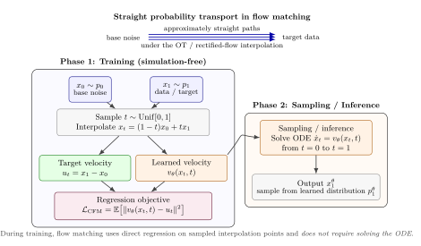
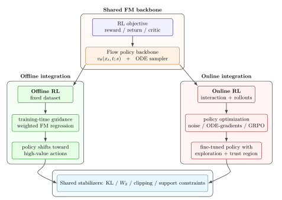

## Overview

This website accompanies our TMLR survey, **“A Survey of Flow Matching in Reinforcement Learning.”** It is intended as a starting point for researchers and newcomers interested in the rapidly growing intersection of flow matching and reinforcement learning.

We organize key papers, methods, code repositories, and learning resources to make the FM-RL literature easier to understand and navigate.

## Paper

### A Survey of Flow Matching in Reinforcement Learning

**Nabuat Zaman Nahim, Fairoz Nower Khan, Peizhong Ju**  
*Transactions on Machine Learning Research (TMLR), 2026* - **Survey Certification**

## Getting Started

If you are new to Flow Matching in Reinforcement Learning, we suggest exploring the material in the following order:

1. **Flow Matching Basics**: Understand the core idea of learning a velocity field that transports samples from a simple source distribution to a target distribution.
2. **Why Flow Matching for RL?**: See why expressive flow based policies can be useful for multimodal action distributions and efficient generation.
3. **FM-RL Taxonomy**: Learn how existing methods differ in what they model and how reinforcement learning signals are incorporated.
4. **Key Papers**: Explore a curated collection of representative FM-RL methods, organized by category.
5. **Code & Resources**: Find available implementations, project pages, and additional learning materials.

## Flow Matching Basics

**Flow Matching (FM)** is a generative modeling framework for learning how to transform samples from a simple distribution, such as Gaussian noise, into samples from a complex target distribution.

The main idea is to learn a **time-dependent velocity field** that tells each sample how it should move over time. Starting from an initial sample \(x_0\), generation follows an ordinary differential equation (ODE):

$$
\frac{dx_t}{dt} = v_\theta(x_t,t)
$$

where $v_\theta(x_t,t)$ is a neural network that predicts the velocity of the sample $x_t$ at time $t$.

Intuitively, you can think of Flow Matching as learning a **transport map**:

**simple noise distribution → learned continuous flow → target data distribution**

  

  <em>Figure 1: Flow Matching in a nutshell. Training is simulation-free, while generation is performed by integrating the learned ODE from the base distribution to the target distribution.</em>

Unlike diffusion models, which are commonly described through iterative stochastic noising and denoising processes, Flow Matching directly learns the vector field governing this transport. This provides a convenient way to build expressive generative models while using an ODE for sampling.

## Why Flow Matching for RL?

A central challenge in reinforcement learning is choosing a policy representation that is both **expressive** and **efficient to sample from**.

Many standard continuous-control algorithms use a diagonal Gaussian policy,

$$
\pi_\theta(a \mid s)
=
\mathcal{N}\!\left(a;\mu_\theta(s),\Sigma_\theta(s)\right),
$$

which represents a single unimodal action distribution for each state. This can be restrictive when several distinct actions are all reasonable. For example, an agent navigating around an obstacle may be able to go either left or right. A unimodal policy may instead place probability mass between these two behaviors.

Flow Matching provides a more expressive alternative. A flow-based policy can transform simple noise into a complex action distribution, allowing it to represent **multimodal and correlated behaviors** that are difficult to capture with a diagonal Gaussian policy.

Generative policies based on diffusion models offer similar expressiveness, but typically generate actions through multiple iterative denoising steps. Flow Matching instead generates samples by integrating a learned deterministic ODE, providing an attractive trade-off between expressive policy modeling and sampling efficiency.

In RL, this makes Flow Matching particularly useful when we want to:

- model complex or multimodal action distributions,
- learn from datasets containing multiple valid behaviors,
- retain the flexibility of a generative policy, and
- reduce the sampling overhead associated with long stochastic denoising chains.

### Policy Representation at a Glance

| Policy type | Expressiveness | Sampling process | Main limitation |
|---|---|---|---|
| **Diagonal Gaussian** | Unimodal | Single network forward pass | Cannot naturally represent multiple distinct action modes |
| **Diffusion policy** | Highly expressive and multimodal | Iterative stochastic denoising | Sampling can require many denoising steps |
| **Flow matching policy** | Highly expressive and multimodal | Integration of a learned ODE | Still requires numerical integration, although often with fewer steps than diffusion |

## FM-RL Taxonomy

The rapidly growing FM-RL literature can be organized along two complementary questions:

1. **What does Flow Matching model inside the RL system?**  
   For example, FM can represent an action policy, a value function, environment dynamics, preferences, or other distributions relevant to decision making.

2. **How does the reinforcement learning signal influence the flow model?**  
   Existing methods differ in whether reward or value information enters through weighted flow matching objectives, policy gradient updates, stochasticized flow trajectories, group relative optimization, or related mechanisms.

This two-axis view helps connect methods that may appear very different at first glance while also making their key design differences explicit.

  

  <em>Figure 2: How Flow Matching is integrated with Reinforcement Learning. Offline methods typically incorporate RL signals during flow model training, while online methods optimize the policy using interaction and policy update mechanisms.</em>

### Axis A: What does the flow model?

Flow Matching can play different roles inside an RL system. The first axis of our taxonomy asks **which distribution or object is represented by the flow**:

- **Actions / Policies**: FM represents the conditional action distribution $\pi(a\mid s)$. This is the most common setting and allows the policy to model complex, multimodal actions.
- **Critics / Values**: FM is used to represent value or return distributions rather than the policy itself.
- **Dynamics / Transitions**: FM models conditional environment transition distributions, such as $p(s' \mid s,a)$.
- **Preferences / Alignment**: FM models transformations or distributions associated with preference learning, alignment, or reward driven generation.

Most existing FM-RL work focuses on **action-policy flows**, while critics, dynamics, and preference modeling remain comparatively less explored.

### Axis B: How does the RL signal enter?

The second axis asks **how reward, value, or preference information is incorporated into the flow model**. Existing approaches can be grouped into four broad mechanisms:

- **Weighted Regression**: The standard flow matching loss is reweighted using reward, advantage, energy, or Q-value information so that higher value samples receive greater emphasis during training. This approach is especially common in offline RL.
- **Direct / Surrogate Gradients**: The flow policy is optimized using policy gradient style objectives, either by differentiating through the flow process or by using a tractable surrogate objective that avoids exact flow likelihood computation.
- **Group-Relative Optimization (GRPO)**: Multiple samples are generated for the same condition, their rewards are compared within the group, and relative advantages are used to update the flow model. This family has become prominent in online fine-tuning of large generative flow models.
- **Other Mechanisms**: Some methods use alternative strategies such as noise injection, one-step policy distillation, support constraints, or modifications to the flow generation process.

Together, Axes A and B provide a two-dimensional view of the field: **what the flow represents** and **how reinforcement-learning information modifies it**.
