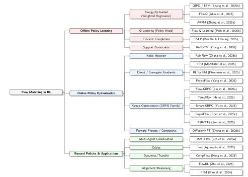

## Overview

This website accompanies our TMLR survey, **“A Survey of Flow Matching in Reinforcement Learning.”** It is intended as a starting point for researchers and newcomers interested in the rapidly growing intersection of flow matching and reinforcement learning.

We organize key papers, methods, code repositories, and learning resources to make the FM-RL literature easier to understand and navigate.

## Paper

### A Survey of Flow Matching in Reinforcement Learning

**Nabuat Zaman Nahim, Fairoz Nower Khan, Peizhong Ju**  
*Transactions on Machine Learning Research (TMLR), 2026* - **Survey Certification**

[](https://arxiv.org/abs/2610.16275)
[](https://tmlr.infinite-conf.org/paper_pages/P6e5IC4gPe.html)
[](https://openreview.net/forum?id=P6e5IC4gPe)
[](https://arxiv.org/pdf/2610.16275)
[](https://www.jmlr.org/tmlr/papers/bib/P6e5IC4gPe.bib)

## Quick Navigation

- [Getting Started](#getting-started)
- [Flow Matching Basics](#flow-matching-basics)
- [Why Flow Matching for RL?](#why-flow-matching-for-rl)
- [FM-RL Taxonomy](#fm-rl-taxonomy)
- [Foundational Reading](#foundational-reading)
- [Key Papers](#key-papers)
- [Code & Resources](#code--resources)
- [Citation](#citation)

## Getting Started

If you are new to Flow Matching in Reinforcement Learning, we suggest exploring the material in the following order:

1. **Flow Matching Basics**: Understand the core idea of learning a velocity field that transports samples from a simple source distribution to a target distribution.
2. **Why Flow Matching for RL?**: See why expressive flow based policies can be useful for multimodal action distributions and efficient generation.
3. **FM-RL Taxonomy**: Learn how existing methods differ in what they model and how reinforcement learning signals are incorporated.
4. **Key Papers**: Explore a curated collection of representative FM-RL methods, organized by category.
5. **Code & Resources**: Find available implementations, project pages, and additional learning materials.

## Flow Matching Basics

**Flow Matching (FM)** is a generative modeling framework for learning how to transform samples from a simple distribution, such as Gaussian noise, into samples from a complex target distribution.

The main idea is to learn a **time-dependent velocity field** that tells each sample how it should move over time. Starting from an initial sample \(x_0\), generation follows an ordinary differential equation (ODE):

$$
\frac{dx_t}{dt} = v_\theta(x_t,t)
$$

where $v_\theta(x_t,t)$ is a neural network that predicts the velocity of the sample $x_t$ at time $t$.

Intuitively, you can think of Flow Matching as learning a **transport map**:

**simple noise distribution → learned continuous flow → target data distribution**

<p align="center">
  
</p>

<p align="center">
  <em>Figure 1: Flow Matching in a nutshell. Training is simulation-free, while generation is performed by integrating the learned ODE from the base distribution to the target distribution.</em>
</p>

Unlike diffusion models, which are commonly described through iterative stochastic noising and denoising processes, Flow Matching directly learns the vector field governing this transport. This provides a convenient way to build expressive generative models while using an ODE for sampling.

## Why Flow Matching for RL?

A central challenge in reinforcement learning is choosing a policy representation that is both **expressive** and **efficient to sample from**.

Many standard continuous-control algorithms use a diagonal Gaussian policy,

$$
\pi_\theta(a \mid s)
=
\mathcal{N}\!\left(a;\mu_\theta(s),\Sigma_\theta(s)\right),
$$

which represents a single unimodal action distribution for each state. This can be restrictive when several distinct actions are all reasonable. For example, an agent navigating around an obstacle may be able to go either left or right. A unimodal policy may instead place probability mass between these two behaviors.

Flow Matching provides a more expressive alternative. A flow-based policy can transform simple noise into a complex action distribution, allowing it to represent **multimodal and correlated behaviors** that are difficult to capture with a diagonal Gaussian policy.

Generative policies based on diffusion models offer similar expressiveness, but typically generate actions through multiple iterative denoising steps. Flow Matching instead generates samples by integrating a learned deterministic ODE, providing an attractive trade-off between expressive policy modeling and sampling efficiency.

In RL, this makes Flow Matching particularly useful when we want to:

- model complex or multimodal action distributions,
- learn from datasets containing multiple valid behaviors,
- retain the flexibility of a generative policy, and
- reduce the sampling overhead associated with long stochastic denoising chains.

### Policy Representation at a Glance

| Policy type | Expressiveness | Sampling process | Main limitation |
|---|---|---|---|
| **Diagonal Gaussian** | Unimodal | Single network forward pass | Cannot naturally represent multiple distinct action modes |
| **Diffusion policy** | Highly expressive and multimodal | Iterative stochastic denoising | Sampling can require many denoising steps |
| **Flow matching policy** | Highly expressive and multimodal | Integration of a learned ODE | Still requires numerical integration, although often with fewer steps than diffusion |

## FM-RL Taxonomy

The rapidly growing FM-RL literature can be organized along two complementary questions:

1. **What does Flow Matching model inside the RL system?**  
   For example, FM can represent an action policy, a value function, environment dynamics, preferences, or other distributions relevant to decision making.

2. **How does the reinforcement learning signal influence the flow model?**  
   Existing methods differ in whether reward or value information enters through weighted flow matching objectives, policy gradient updates, stochasticized flow trajectories, group relative optimization, or related mechanisms.

This two-axis view helps connect methods that may appear very different at first glance while also making their key design differences explicit.

<p align="center">
  
</p>

<p align="center">
  <em>Figure 2: How Flow Matching is integrated with Reinforcement Learning. Offline methods typically incorporate RL signals during flow model training, while online methods optimize the policy using interaction and policy update mechanisms.</em>
</p>

<p align="center">
  
</p>

<p align="center">
  <em>Figure 3: Taxonomy of Flow Matching in Reinforcement Learning. Methods are organized into Offline Policy Learning, Online Policy Optimization, and applications Beyond Policy Learning.</em>
</p>

### Axis A: What does the flow model?

Flow Matching can play different roles inside an RL system. The first axis of our taxonomy asks **which distribution or object is represented by the flow**:

- **Actions / Policies**: FM represents the conditional action distribution $\pi(a\mid s)$. This is the most common setting and allows the policy to model complex, multimodal actions.
- **Critics / Values**: FM is used to represent value or return distributions rather than the policy itself.
- **Dynamics / Transitions**: FM models conditional environment transition distributions, such as $p(s' \mid s,a)$.
- **Preferences / Alignment**: FM models transformations or distributions associated with preference learning, alignment, or reward driven generation.

Most existing FM-RL work focuses on **action-policy flows**, while critics, dynamics, and preference modeling remain comparatively less explored.

### Axis B: How does the RL signal enter?

The second axis asks **how reward, value, or preference information is incorporated into the flow model**. Existing approaches can be grouped into four broad mechanisms:

- **Weighted Regression**: The standard flow matching loss is reweighted using reward, advantage, energy, or Q-value information so that higher value samples receive greater emphasis during training. This approach is especially common in offline RL.
- **Direct / Surrogate Gradients**: The flow policy is optimized using policy gradient style objectives, either by differentiating through the flow process or by using a tractable surrogate objective that avoids exact flow likelihood computation.
- **Group-Relative Optimization (GRPO)**: Multiple samples are generated for the same condition, their rewards are compared within the group, and relative advantages are used to update the flow model. This family has become prominent in online fine-tuning of large generative flow models.
- **Other Mechanisms**: Some methods use alternative strategies such as noise injection, one-step policy distillation, support constraints, or modifications to the flow generation process.

Together, Axes A and B provide a two-dimensional view of the field: **what the flow represents** and **how reinforcement learning information modifies it**.

### Representative Methods at a Glance

| Method | Setting | What FM models | How RL enters |
|---|---|---|---|
| **QIPO / EFM** | Offline RL | Action policy | Q/energy-weighted flow-matching regression |
| **FlowQ** | Offline RL | Action policy | Q-guided training-time flow matching |
| **FQL** | Offline / Offline-to-Online RL | Behavior policy + one-step actor | Q-learning with distillation from a flow policy |
| **FPO** | Online RL | Action policy | Policy optimization using a flow-matching surrogate |
| **ReinFlow** | Online RL | Action policy | Noise injection + policy optimization |
| **Flow-GRPO** | Online RL / Alignment | Generative policy | Group-relative optimization after ODE-to-SDE conversion |
| **floq** | Value-based RL | Q-function / critic | TD learning with a flow-matching critic |
| **CompFlow** | Offline-to-Online RL | Transition dynamics | Flow-based dynamics modeling and Wasserstein gap estimation |
| **PFM** | Preference alignment | Preference transformation | Direct learning from preference pairs |

## Foundational Reading

If you are new to Flow Matching itself, these papers are useful starting points before diving into FM-RL methods:

- **Flow Matching for Generative Modeling**: Lipman, Chen, Ben-Hamu, Nickel, and Le, ICLR 2023.  
  Introduces Flow Matching as a simulation-free framework for training continuous normalizing flows by regressing vector fields along conditional probability paths.  
  [Paper](https://arxiv.org/abs/2210.02747)

- **Flow Straight and Fast: Learning to Generate and Transfer Data with Rectified Flow**: Liu, Gong, and Liu, ICLR 2023.  
  Introduces Rectified Flow, which learns approximately straight transport paths between distributions and motivates efficient ODE-based generation.  
  [Paper](https://arxiv.org/abs/2209.03003)

- **Flow Matching Guide and Code**: Lipman et al., 2024.  
  A broader tutorial-style treatment of Flow Matching covering mathematical foundations, design choices, and practical implementations.  
  [Paper](https://arxiv.org/abs/2412.06264)

## Key Papers

Below is a curated selection of representative papers in Flow Matching for Reinforcement Learning. We organize them by the role that Flow Matching plays and the way RL information is incorporated.

> **Naming note:** Two different papers use the name **FlowRL**:
>
> - **Flow-Based Policy for Online Reinforcement Learning (FlowRL)**: Lv et al., 2025: flow based action policies for online RL with Wasserstein-2 regularized optimization.
> - **FlowRL: Matching Reward Distributions for LLM Reasoning**: Zhu et al., 2025: reward distribution matching for diverse LLM reasoning.
>
> They address different problems and should not be confused.

### Offline Policy Learning

- **Guided Flows for Generative Modeling and Decision Making**: Zheng, Le, Shaul, Lipman, Grover, and Chen, arXiv preprint 2023.  
  Extends classifier free guidance to Flow Matching and applies it to **return conditioned plan generation in offline reinforcement learning**. The method generates plans conditioned on the current state and desired return, demonstrating how flow based generative models can be used for decision making while offering substantially faster sampling than the diffusion baseline studied in the paper.  
  [Paper](https://arxiv.org/abs/2311.13443)

- **On the Guidance of Flow Matching**: Feng, Yu, Deng, Hu, and Wu, ICML 2025.  
  Develops a general theoretical framework for **guiding flow matching models toward high value or desired samples**. The paper derives exact and approximate guidance methods, including training free and training based variants, and evaluates them on offline reinforcement learning in addition to other generative tasks.  
  [Paper](https://arxiv.org/abs/2502.02150) · [Code](https://github.com/AI4Science-WestlakeU/flow_guidance)

- **Energy-Weighted Flow Matching for Offline Reinforcement Learning (QIPO / EFM)**: Zhang, Zhang, and Gu, ICLR 2025.  
  Introduces energy-weighted flow matching and applies it to offline RL through Q-weighted Iterative Policy Optimization (QIPO), directly biasing the learned flow toward high value actions.  
  [Paper](https://arxiv.org/abs/2503.04975)

- **FlowQ: Energy-Guided Flow Policies for Offline Reinforcement Learning**: Alles, Chen, van der Smagt, and Cseke, arXiv preprint 2025.  
  Uses the Q-function as an energy signal to train an energy-guided flow policy, incorporating value guidance during training rather than at inference time.  
  [Paper](https://arxiv.org/abs/2505.14139)

- **Flow Matching for Offline Reinforcement Learning with Discrete Actions (QDFM)**: Khan, Nahim, Huang, Yang, and Ju, NeurIPS 2026.  
  Extends Flow Matching to **offline reinforcement learning with discrete action spaces** by replacing continuous ODE-based flows with **Continuous-Time Markov Chains (CTMCs)**. QDFM trains the discrete flow using a Q-weighted flow matching objective, supports multiple reward objectives through preference conditioned value guidance, and extends to multi-agent settings using a factorized conditional path to avoid explicitly modeling the exponentially large joint action space.  
  [Paper](https://arxiv.org/abs/2602.06138)

- **Flow Q-Learning (FQL)**: Park, Li, and Levine, ICML 2025.  
  Trains a flow matching behavior policy and distills it into an expressive one-step policy that is optimized using Q-learning, avoiding backpropagation through the iterative flow process.  
  [Paper](https://arxiv.org/abs/2502.02538) · [Project Page](https://seohong.me/projects/fql/)

- **Adaptive Reinforced Flow Matching (ARFM)**: Zhang et al., AAAI 2026.  
  Develops an offline RL post-training method for flow-based vision-language-action models that adaptively controls the strength of the RL signal to balance advantage preservation against gradient variance.  
  [Paper](https://arxiv.org/abs/2509.04063)

- **Flow-Based Single-Step Completion for Efficient and Expressive Policy Learning (SSCP)**: Koirala and Fleming, ICLR 2026.  
  Learns completion vectors that allow a flow-based policy to generate actions in a single step, avoiding long iterative sampling and backpropagation chains while retaining an expressive policy representation.  
  [Paper](https://arxiv.org/abs/2506.21427)

- **ReFORM: Reflected Flows for On-support Offline RL via Noise Manipulation**: Zhang, So, Ahmad, Yu, Cleaveland, Black, and Fan, ICLR 2026.  
  Addresses **out of distribution actions in offline RL** by enforcing a support constraint directly through the flow policy construction. ReFORM first learns a behavior cloning flow with a bounded latent distribution, then optimizes a reflected flow that manipulates the latent noise while keeping it inside the original support, allowing policy improvement without leaving the behavior policy's action support.  
  [Paper](https://arxiv.org/abs/2602.05051)

### Online Policy Optimization

- **Flow Matching Policy Gradients (FPO)**: McAllister, Ge, Yi, Kim, Weber, Choi, Feng, and Kanazawa, ICLR 2026.  
  Introduces Flow Policy Optimization (FPO), an on-policy method that uses the conditional flow matching objective as a surrogate for policy optimization, avoiding exact likelihood computation while remaining compatible with PPO-style clipping.  
  [Paper](https://arxiv.org/abs/2507.21053) · [Project Page](https://flowreinforce.github.io)

- **Reinforcement Learning for Flow-Matching Policies**: Pfrommer, Huang, and Sojoudi, arXiv preprint 2025.  
  Studies reinforcement learning for flow matching policies in robotics and introduces both Reward-Weighted Flow Matching (RWFM) and a GRPO-based approach with a learned reward surrogate. The paper also considers variable horizon flow matching planning for minimum time control.  
  [Paper](https://arxiv.org/abs/2507.15073) · [Code](https://github.com/spfrommer/flowmatching_policy_rl)

- **PolicyFlow: Policy Optimization with Continuous Normalizing Flow in Reinforcement Learning**: Yang, Liu, and Chen, ICLR 2026.  
  Adapts **Proximal Policy Optimization (PPO)** to continuous normalizing flow policies. Because exact flow policy likelihoods require integrating the divergence of the velocity field along the ODE trajectory, PolicyFlow uses an efficient approximation of the likelihood ratio, enabling PPO-style clipped policy updates while retaining an expressive multimodal flow policy.  
  [Paper](https://arxiv.org/abs/2602.01156)

- **ReinFlow: Fine-tuning Flow Matching Policy with Online Reinforcement Learning**: Zhang, Yu, Su, and Wang, NeurIPS 2025.  
  Adds learnable noise to deterministic flow trajectories, turning them into a discrete time stochastic process with tractable transition likelihoods. This enables stable online RL fine tuning of flow policies for robotic control.  
  [Paper](https://arxiv.org/abs/2505.22094) · [Project Page](https://reinflow.github.io/)

- **Flow-Based Policy for Online Reinforcement Learning (FlowRL)**: Lv, Li, Luo, Sun, Kong, Xu, and Ma, NeurIPS 2025.  
  Develops an online RL framework with a flow based policy and **Wasserstein-2 regularized policy optimization**. The method uses replay buffer data as a reference distribution, encouraging the policy to remain close to high value behaviors while still optimizing Q-values and preserving multimodality.  
  [Paper](https://arxiv.org/abs/2506.12811)

- **Online Reward-Weighted Fine-Tuning of Flow Matching with Wasserstein Regularization (ORW-CFM-W2)**: Fan et al., ICLR 2025.  
  Fine tunes flow matching generative models online using reward-weighted conditional flow matching. Wasserstein-2 regularization is added to preserve diversity and reduce policy collapse, while avoiding explicit continuous flow likelihood computation.  
  [Paper](https://arxiv.org/abs/2502.06061)

- **Adaptive Divergence Regularized Policy Optimization (ADRPO)**: Fan, Wei, Cheng, Chen, and Liu, NeurIPS 2025.  
  Extends divergence regularized RL fine tuning by making the regularization strength **adaptive to the advantage of each sample**. High advantage samples receive weaker regularization to allow more aggressive optimization, while low advantage samples receive stronger regularization for stability. For flow matching models, the method uses Wasserstein-2 regularization during online fine tuning.  
  [Paper](https://arxiv.org/abs/2510.18053)

- **Flow-GRPO: Training Flow Matching Models via Online RL**: Liu et al., NeurIPS 2025.  
  Adapts Group Relative Policy Optimization (GRPO) to flow matching models by converting deterministic ODE sampling into an equivalent stochastic SDE formulation, enabling exploration and online reward based optimization.  
  [Paper](https://arxiv.org/abs/2505.05470) · [Code](https://github.com/yifan123/flow_grpo)

- **Coefficients-Preserving Sampling for Reinforcement Learning with Flow Matching (CPS)**: Wang and Yu, arXiv preprint 2025.  
  Studies a weakness of SDE-based stochastic sampling used in online RL for flow matching models: excessive injected noise can leave visible artifacts in generated samples and distort reward estimation. CPS reformulates the sampling process so that the latent noise coefficients remain consistent with the original scheduler, improving sample quality and stabilizing RL optimization.  
  [Paper](https://arxiv.org/abs/2509.05952)

- **TempFlow-GRPO: When Timing Matters for GRPO in Flow Models**: He et al., ICLR 2026.  
  Extends Flow-GRPO by making optimization **time-aware**. It introduces trajectory branching for more precise credit assignment and noise aware weighting so that timesteps with greater exploration impact receive stronger updates.  
  [Paper](https://arxiv.org/abs/2508.04324) · [Project Page](https://tempflowgrpo.github.io/)

- **Smart-GRPO: Smartly Sampling Noise for Efficient RL of Flow-Matching Models** — Yu, Liu, and Cui, AAAI 2026.  
  Improves GRPO-style training by treating the choice of injected noise as an optimization problem. Instead of sampling perturbations uniformly, Smart-GRPO searches for noise seeds that are more likely to produce informative, high-reward generations, improving sampling efficiency during RL fine tuning.  
  [Paper](https://arxiv.org/abs/2510.02654)

- **SuperFlow: Training Flow Matching Models with RL on the Fly**: Chen et al., AACL 2026.  
  Improves RL training efficiency for flow models with two ideas: **variance-aware group sampling**, which allocates more samples to prompts with more informative reward variation, and **step-level advantage re-estimation**, which provides more accurate credit assignment across the flow trajectory.  
  [Paper](https://arxiv.org/abs/2512.17951) · [Code](https://github.com/jkkjjj/superflow)

- **Fine-Grained GRPO for Precise Preference Alignment in Flow Models**: Zhou, Ling, Bu, Wang, Zang, Wang, Niu, and Zhai, CVPR 2026.  
  Extends GRPO-style flow model fine tuning with **fine grained credit assignment along the generation trajectory**. Instead of assigning the same terminal reward to every flow step, the method derives step-level reward signals from intermediate generations, allowing optimization to identify which stages of the flow trajectory contribute to better or worse final outputs.  
  [Paper](https://arxiv.org/abs/2510.01982)

- **Advantage Weighted Matching: Aligning RL with Pretraining in Diffusion Models (AWM)**: Xue, Ge, Zhang, Li, and Ma, ICML 2026.  
  Proposes a simpler alternative to GRPO-style optimization by **reweighting the original matching objective with exponentiated advantages**, keeping RL fine tuning closely aligned with the model's pretraining objective. This avoids the additional noisy target score matching construction used by some GRPO approaches and substantially improves training efficiency.  
  [Paper](https://arxiv.org/abs/2509.25050)

- **GRPO-Guard: Mitigating Implicit Over Optimization in Flow Matching via Regulated Clipping**: Wang et al., CVPR 2026.  
  Identifies an **implicit over optimization problem** in Flow-GRPO: the importance ratio distribution can become systematically shifted and vary across flow timesteps, weakening PPO-style clipping for positive advantage samples. GRPO-Guard addresses this with **ratio normalization** and **timestep aware gradient reweighting**, restoring more balanced clipping and stabilizing flow model fine tuning.  
  [Paper](https://arxiv.org/abs/2510.22319)

- **Fine-Tuning Flow Matching Generative Models with Intermediate Feedback (AC-Flow)**: Fan, Cheng, Shen, Zhou, and Liu, arXiv preprint 2025.  
  Addresses the coarse credit assignment of using only a final reward for an entire flow generation trajectory. AC-Flow introduces **intermediate feedback at selected flow timesteps**, using auxiliary evaluators to assess partially generated samples and provide more localized learning signals during RL fine-tuning.  
  [Paper](https://arxiv.org/abs/2510.18072)

- **F5R-TTS: Improving Flow-Matching based Text-to-Speech with Group Relative Policy Optimization**: Sun, Xiao, Mo, Wu, Yu, and Wang, arXiv preprint 2025.  
  Applies GRPO to a flow matching-based text-to-speech model. The method reformulates deterministic flow outputs as probabilistic Gaussian distributions so that RL can be applied, then optimizes speech quality using word error rate and speaker similarity rewards.  
  [Paper](https://arxiv.org/abs/2504.02407) · [Project Page](https://frontierlabs.github.io/F5R/)

- **DiffusionNFT: Online Diffusion Reinforcement with Forward Process**: Zheng et al., ICLR 2026.  
  Provides a bridge between diffusion-based RL and Flow Matching by optimizing a diffusion model through its **forward process** rather than requiring intractable reverse process likelihoods. The method contrasts higher and lower reward generations to obtain an implicit policy improvement signal and converts this signal into a supervised flow matching objective.  
  [Paper](https://arxiv.org/abs/2509.16117)
  
### Beyond Policies & Applications

Flow Matching is increasingly being used for RL components beyond action-policy generation.

- **Multi-Agent Coordination via Flow Matching (MAC-Flow)**: Dongsu Lee, Daehee Lee, and Amy Zhang, ICLR 2026.  
  Extends flow matching policies to **multi-agent reinforcement learning**. MAC-Flow first learns a centralized flow based model of the joint behavior of multiple agents from offline data, capturing multimodal coordination patterns, and then distills this model into decentralized one-step policies so that each agent can execute efficiently without iterative flow sampling.  
  [Paper](https://arxiv.org/abs/2511.05005) · [Code](https://github.com/DongsuLeeTech/mac-flow)

- **floq: Training Critics via Flow-Matching for Scaling Compute in Value-Based RL**: Agrawalla, Nauman, Agrawal, and Kumar, ICLR 2026.  
  Uses flow matching to parameterize the **Q-function itself**, turning value estimation into an iterative computation process with supervision across flow steps.  
  [Paper](https://arxiv.org/abs/2509.06863) · [Code](https://github.com/CMU-AIRe/floq)

- **Unleashing Flow Policies with Distributional Critics (DFC)**: Chen, Liu, Zhou, Qu, and Qi, arXiv preprint 2025.  
  Introduces the **Distributional Flow Critic (DFC)**, which uses Flow Matching to model the full distribution of future returns instead of predicting only a scalar expected Q-value. To make this practical for actor-critic learning, DFC uses a two-stage design: a multi-step flow critic learns the distributional Bellman target, while its output is distilled into an efficient one-step quantile critic for policy updates.  
  [Paper](https://arxiv.org/abs/2509.23087)

- **FlowCritic: Bridging Value Estimation with Flow Matching in Reinforcement Learning**: Zhong, Ding, Diao, Wang, Teh, and Peng, IEEE Transactions on Pattern Analysis and Machine Intelligence (TPAMI), 2026.
  Uses Flow Matching to build an expressive **distributional critic** for reinforcement learning. Rather than predicting a single scalar value, FlowCritic models a distribution over returns and is designed to support efficient gradient computation for actor updates, connecting flow based value modeling with practical actor-critic optimization.  
  [Paper](https://arxiv.org/abs/2510.22686)

- **Expressive Value Learning for Scalable Offline Reinforcement Learning (EVOR)**: Espinosa-Dice, Brantley, and Sun, arXiv preprint 2025.  
  Uses Flow Matching to learn an expressive **distributional Q-function** that models the full reward to go distribution rather than only its expectation. EVOR avoids policy distillation and backpropagation through long flow trajectories; instead, it performs inference time policy extraction by using the learned value model to select high value actions through rejection sampling.  
  [Paper](https://arxiv.org/abs/2510.08218) · [Project Page](https://nico-espinosadice.github.io/projects/evor/)  

- **Composite Flow Matching for Reinforcement Learning with Shifted-Dynamics Data (CompFlow)**: Kong, Wang, Wang, Xiong, and Tambe, NeurIPS 2025.  
  Uses conditional flows to model **environment transition dynamics** and estimate the mismatch between offline and online dynamics through Wasserstein distance.  
  [Paper](https://arxiv.org/abs/2505.23062)

- **Preference Alignment with Flow Matching (PFM)**: Kim, Lee, Kang, Oh, Chong, and Yun, NeurIPS 2024.  
  Learns a flow that transforms less-preferred outputs into preferred ones, providing a flow-based approach to **preference alignment** without explicitly learning a reward model.  
  [Paper](https://arxiv.org/abs/2405.19806) · [Code](https://github.com/jadehaus/preference-flow-matching)

- **FlowRL: Matching Reward Distributions for LLM Reasoning**: Zhu et al., ICLR 2026.  
  Reframes reinforcement learning for LLM reasoning as **reward distribution matching** rather than simply maximizing expected reward. FlowRL converts scalar rewards into a normalized target distribution and uses a flow balancing objective to encourage diverse, high quality reasoning trajectories while reducing mode collapse.  
  [Paper](https://arxiv.org/abs/2509.15207) · [Code](https://github.com/Xuekai-Zhu/FlowRL)

## Code & Resources

Several FM-RL papers provide public implementations or project pages that are useful for reproducing results and understanding the methods in practice.

- **Flow Q-Learning (FQL)**: [Project Page](https://seohong.me/projects/fql/)  
  Offline RL with a flow matching behavior policy and a distilled one-step actor.

- **Flow-GRPO**: [GitHub](https://github.com/yifan123/flow_grpo)  
  Online GRPO-style optimization for flow matching generative models.

- **ReinFlow**: [Project Page](https://reinflow.github.io/)  
  Online RL fine tuning of flow matching policies for robotic control.

- **Flow Matching Policy Gradients (FPO)**: [Project Page](https://flowreinforce.github.io)  
  Resources accompanying Flow Policy Optimization.

- **floq**: [GitHub](https://github.com/CMU-AIRe/floq)  
  Flow matching-based Q-function modeling for value based RL.

- **Preference Flow Matching (PFM)**: [GitHub](https://github.com/jadehaus/preference-flow-matching)  
  Preference alignment using flow matching.

- **On the Guidance of Flow Matching**: [GitHub](https://github.com/AI4Science-WestlakeU/flow_guidance)  
  General flow matching guidance methods, including experiments in offline RL.

## Contributing

We welcome suggestions that can help keep this resource useful and up to date.

If you know of a relevant paper, code repository, project page, or other FM-RL resource that is missing, please feel free to **open an issue or submit a pull request**.

When suggesting a paper, please include:

- paper title and link,
- authors and year,
- code or project-page link, if available, and
- a brief note explaining how the work relates to Flow Matching and Reinforcement Learning.

Corrections and suggestions for improving the tutorial are also welcome.

  ## Citation

If you find this survey or resource useful, please consider citing our paper:

```bibtex
@article{
nahim2026a,
title={A Survey of Flow Matching in Reinforcement Learning},
author={Nabuat Zaman Nahim and Fairoz Nower Khan and Peizhong Ju},
journal={Transactions on Machine Learning Research},
issn={2835-8856},
year={2026},
url={https://openreview.net/forum?id=P6e5IC4gPe},
note={Survey Certification}
}
```
